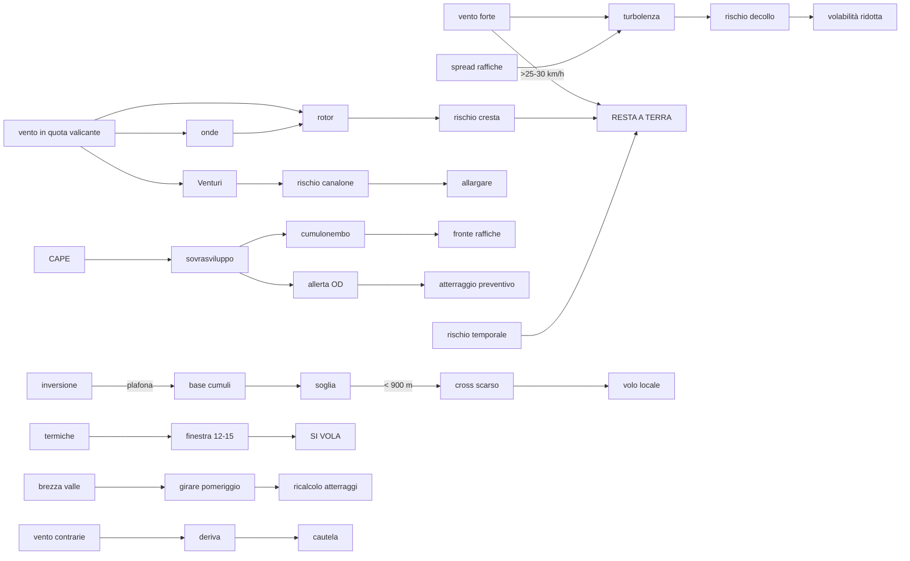

# FASE 2 — Grafo di conoscenza

Fonte della verità: [`grafo-conoscenza.json`](grafo-conoscenza.json) — **40 nodi, 43 archi**.
Gli agenti (Fase 4) percorrono questi archi per costruire le spiegazioni a catena
("perché il verdetto dice NO": risalgo la catena fino alla causa).

Relazioni usate: `CAUSA · AUMENTA · PRODUCE · SEGNALE · BLOCCA · VETA · ATTIVA ·
RAFFORZA · SUGGERISCE · MITIGA · PLAFONA · SBRINDOLA · ALIMENTA · RICALCOLA`.

## Le catene chiave (stile "mappa concettuale")

**Vento → decollo**
- vento forte → turbolenza
- turbolenza → rischio decollo
- rischio decollo → volabilità ridotta
- spread raffiche → turbolenza (il disordine si misura, non si sente)
- vento forte > 25-30 km/h → BLOCCA DECOLLO

**Quota → cross**
- base bassa → soglia piccola → cross scarso
- cross scarso → suggerire volo locale
- inversione → plafona la base (tetto reale = min(LCL, inversione))

**Onda/rotor**
- vento in quota valicante → onde → rotori forti e fissi
- vento in quota → rotor → rischio cresta → VETO (SafetyAgent)

**Venturi**
- vento in quota → Venturi (valle stretta allineata) → rischio canalone → suggerire "allargare"

**Temporali**
- CAPE → sovrasviluppo → cumulonembo → fronte di raffiche (30-60 km/h)
- sovrasviluppo → allerta OD → atterraggio preventivo
- rischio temporale → VETO (SafetyAgent: WMO 95/96/99, CAPE > 1500 + pioggia)

**Brezze**
- brezza di monte → inversione/al suolo (aria fredda stagnante)
- brezza di valle → girare del pomeriggio → ricalcolare gli atterraggi (campo controvento alle 11 = sottovento alle 15)

**Deriva / XC**
- vento in quota contrarie → deriva → rientro impossibile → cautela (ricalcolare glide)
- atterraggi raggiungibili → MITIGA la deriva ("si vola solo dove si vede un campo")

**Termiche → finestra**
- termiche → picco convettivo 12-15 → apre SI VOLA (con cielo ordinato ed esposizione frontale)

## Estrarre spiegazioni dal grafo (come lo userà il Decision Engine)

```pseudo
spiegazione(veto) = catena più corta da {causa} → {rischio} → {verdetto}
es.: vento_quota → rotor → rischio_rotor → RESTA A TERRA
     "il vento valica la cresta a X km/h: di sottovento si forma il rotore
      che rende l'ala ingovernabile: si decolla solo restando sopravvento"
```

## Codice Mermaid (catene principali — incollabile su mermaid.live)


